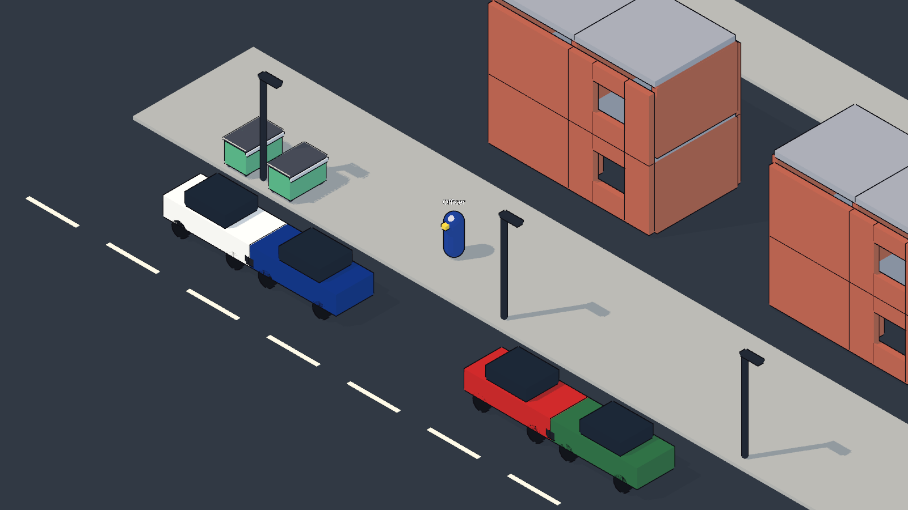
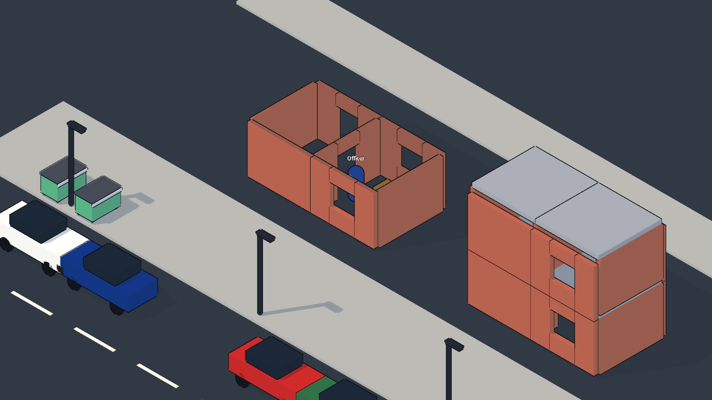
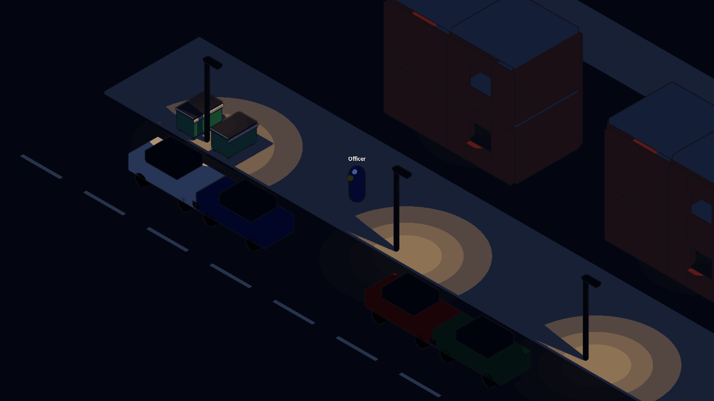
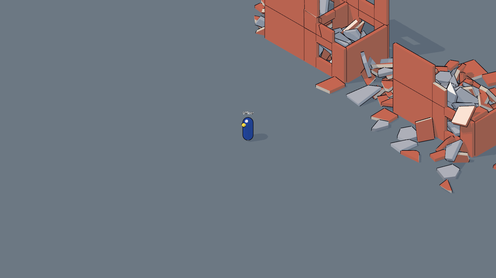
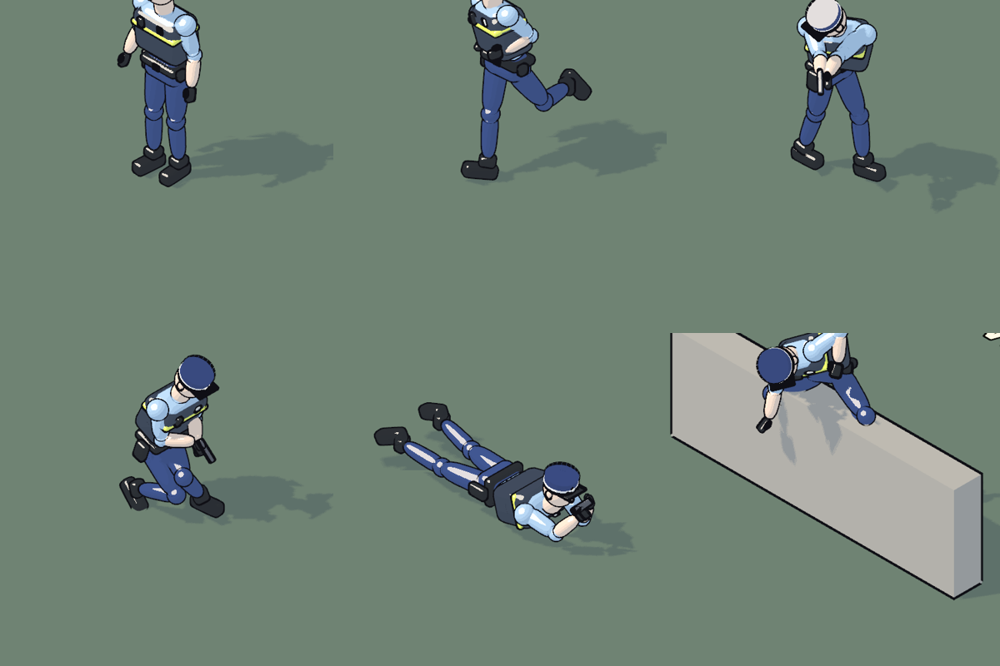
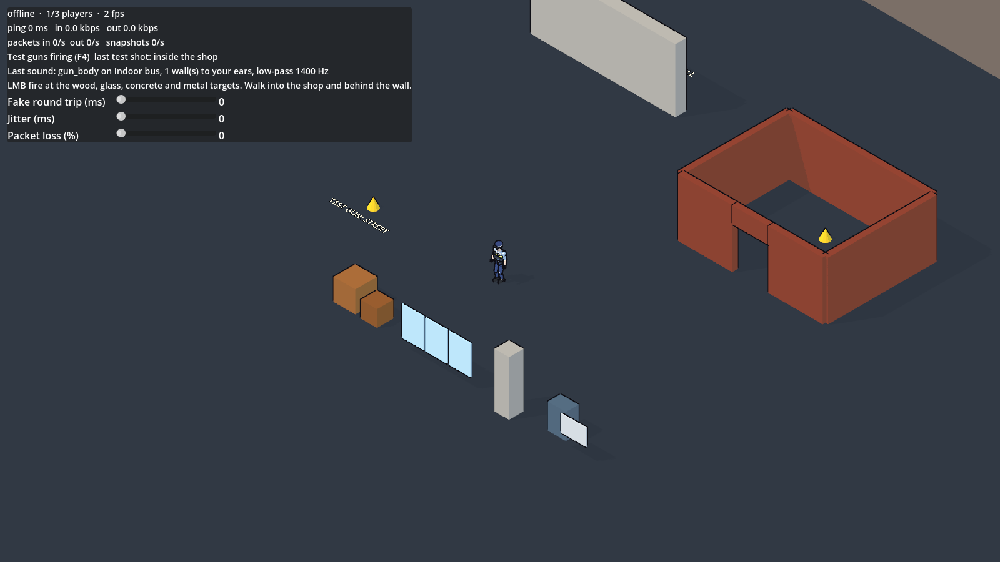

# Wave 0: prove the hard parts

Wave 0 is throwaway test scenes that each prove one risky part of The Popo
before Wave 1 builds the first playable block on top of them. Everything runs
in Godot 4.7.2 with Jolt physics. Up to 3 players, direct IP, host
authoritative.

## How to run

1. Open the project in Godot 4.7.2 (or run the exported build).
2. The launcher opens. One player clicks **Host** (default port 27015, which the host forwards on their router for friends outside the house).
   Friends type the host's address and port and click **Join**. You can also
   play alone: the host is a player.
3. The host picks a prototype and everyone in the lobby loads it.
4. In any prototype: **F3** shows the net overlay (ping, bandwidth and fake
   latency, jitter and loss sliders), **Esc** goes back to the launcher.

Common controls: WASD move (relative to the camera), mouse aims, LMB fire,
RMB aim, Shift sprint, Space jump/vault/climb, Q/E rotate the camera (tap to
snap 45 degrees, hold to turn), mouse wheel zooms.

Tests: `godot --headless --path . -s res://tests/runner.gd` (26 tests), plus
the two-process net probes in `tests/net/` (see `.github/workflows/ci.yml`).

## Results

| Phase | Prototype | Result |
|---|---|---|
| 0.1 | Pipeline check | Blender prop (made by script) imports with collision; Jolt on; CI builds and tests. |
| 0.2 | Two players in one room | Prediction with replay and 100 ms interpolation. At 150 ms round trip with 10% loss, host and client agree on position to 0 m once settled. |
| 0.3 | Destruction spike and stress | Voronoi pre-fractured kit, support graph, real Jolt chunks. Two-process collapse tests at 100 ms and 5% loss (54 to 161 synced bodies, depending on how it breaks): worst host/client mismatch 1.2 cm. A falling slab no longer wrecks the slab it tore away from just by scraping past it. Stress: 60 walls / 1,080 chunks, about 3 ms average and 11 ms worst physics step on a 4-core cloud box. Bandwidth capped at about 306 kbps by a 110-body budget. |
| 0.4 | Car spike | Time from key press until the car has moved 3 cm, at 100 ms round trip: about 117 ms when the driver's own PC simulates the car (the same as offline: that is just the car pulling away) against about 370 to 420 ms when the host does. **Driver authority chosen** (T toggles to compare). 0 to 56 km/h in 3 s, coasts to a stop from 33 km/h in about 6 s, dents of about 23 cm, bumper comes off. |
| 0.5 | Look spike | Cel shading banded on real light (day and night), outlines, iso camera rotate and zoom, upper floors and roofs fade when you walk in but keep their shadows. |
| 0.6 | Movement course | Blender officer with the mocap clips (run, aim, roll, mantle, peek) plus hand-keyed clips, procedural aim twist, foot IK and hand lock, vault/climb/slide/roll/crawl/cover, partial and full ragdoll. All traversal tests pass. |
| 0.7 | Sound spike | Layered handgun (mechanism, crack, body, outdoor echo tail), indoor room reverb vs outdoor slapback by zone, muffling per wall between the shot and your ears, impacts on wood, glass, concrete and metal, synced host to clients. |

## Gate

The Wave 0 gate is that each hard part works well enough to build on. Status:

- Netcode: **passed** in automated tests at 150 ms and 10% loss. Still needs
  a real session between two of your PCs over the internet with port
  forwarding.
- Destruction sync: **passed** in tests. Needs a feel check by eye.
- Car: **passed**, driver authority chosen. Needs a feel check on handling.
- Look: **passed** on screenshots. The officer model still needs the
  improvements you mentioned.
- Movement: **passed** in tests. Needs a feel check with mouse and keyboard.
- Sound: **works**, but uses synthesised placeholder sounds. Real recordings
  come in from the free libraries (Sonniss GDC bundles, Freesound, Kenney)
  during Wave 1; every file is logged with its source and licence in
  `assets/audio/manifest.csv`.

## Known issues

- The placeholder sounds are made from scratch by
  `tools/audio/synth_placeholders.py`. They prove the engine side; they will
  not sound as good as real recordings.
- A falling slab can come to rest wedged on the rubble of the wall below
  rather than reaching the ground. That is physically fine but worth watching.
- The physics cost numbers come from a 4-core cloud machine with software
  rendering; a gaming PC should be well under them.
- Glass panes in the sound scene just vanish and come back. Real glass
  shattering comes with the destruction work in Wave 1.
- The officer's mocap clips have known rough spots: the roll's left hand
  hovers about 8 cm, the aim arms are slightly winged, and the peek's cover
  wall contact is weak.
