# Wave 1: first playable block

Wave 1 turns the Wave 0 prototypes into one small game loop on a generated
city block. It is built phase by phase; each phase ends with a build.

## Phase 1.1: kit and generator, version 1 (v0.2.0)

- Grid standard: [grid.md](grid.md) (4 m modules, 3.25 m storeys).
- Kit: 34 pieces (walls, shop fronts, garage, parapets, interior walls,
  floors, stairwell and stairs, roofs, columns, glass, doors, pavement,
  roads, crossings, low wall, bollard, lamp post), each with its fractured
  twin, from `tools/blender/build_kit_fractured.py`.
- Generator: `game/city/block_generator.gd` lays out one block from a seed:
  a road ring with lane dashes and crossings, pavement, and 4 to 6 buildings
  (shops, houses, garages, 1 to 3 storeys, recoloured per building). Two are
  enterable, with rooms, an interior door and stairs to the floor above.
- Everything is breakable: the block is built into the DestructionWorld, so
  walls, floors, glass and lamp posts shatter and fall like the Wave 0 shops.
- Same seed, same block: checked by `tests/unit/test_city_block.gd` (same
  fingerprint for the same seed, a different one for another seed; 40 seeds
  checked for 4 to 6 buildings, two enterable, none overlapping; the whole
  block stands; an officer walks up the stairs). The host sends the seed to
  everyone, so all machines build the same block with the same piece ids.
- Officers now step up stairs and kerbs (up to 0.36 m).
- Playable as "1.1 City block" in the launcher. G (host) builds a new block
  for everyone.

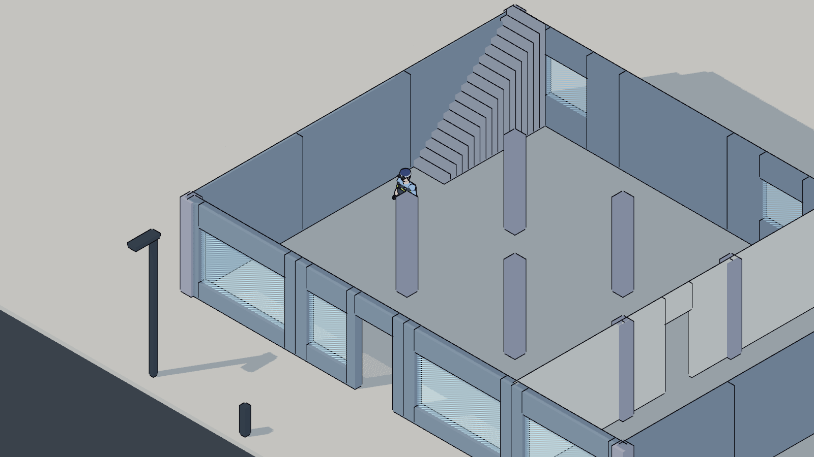

## Phase 1.2: movement and gunplay (v0.2.1)

- Climb, roll and mantle polish: hands stay on the ledge through a climb,
  rolls and vaults finish at running pace instead of stopping dead.
- Gun handling: 15-round magazine, reload (R), holster and draw (H), recoil
  kick and spread bloom, blind fire from cover (fire without aiming), torch
  (T) that everyone sees.
- Traversal: one forward scan finds the top of whatever is ahead, so the
  officer vaults low walls, car bonnets and window sills once the glass is
  gone (glass shards and splinters never block), and climbs ledges up to
  2.4 m.
- Cover: walls, cars and rubble all give cover. In cover, a direction plus
  the cover key runs to the next cover that way (up to 10 m), or swings round
  the end of the wall to its side face.
- Melee: punch (shoves and hurts), kick (bursts doors in off their hinges,
  breaks other pieces), and a shoulder barge when sprinting. All hits are
  worked out on the host (`game/actors/melee.gd`).
- Health: 100 hp. Shots (friendly fire is on), blasts and falls of more than
  about 4 m hurt. At zero the officer goes down (full ragdoll); a teammate
  holding interact next to them for 2 s gets them up with 50 hp, or they get
  up alone after 30 s with 25 hp. Health, revive progress and stagger are in
  the synced officer state.
- Playable as "1.2 Training yard" in the launcher; the City block also has
  melee, kickable doors and friendly fire.
- Ladders are left for later: none of the kit pieces needs one yet.

### v0.2.2: officer model fixes (beenster's playtest)

- Arms and legs are now single skinned tubes (`skinned_limb` in
  `tools/blender/officer/officer.py`), with weights blended across the
  elbow and knee, so the ball joints are gone. The torso and vest are
  lofted, skinned shells, narrow under the arms so the arms hang clear.
- Navy baseball cap with a curved peak and yellow lettering replaces the
  police hat.
- Prone: elbows down, both hands forward on the pistol, barrel level.
- Aiming at the ground near the feet no longer folds the body over (the
  barrel line-up ignores points closer than 1 m and limits the pitch).
- Kicked-in doors come off their frame and fall in.

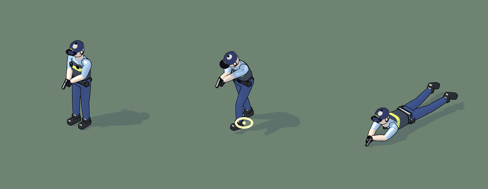

### v0.2.3: menus, settings, cover and animation fixes (beenster's playtest)

- Opening menu (`game/ui/main_menu.tscn`, now the main scene): Single
  Player (pick a scene), Online (the host / join lobby), Settings, Quit.
  Esc in a game opens a pause menu (Resume, Settings, Leave to main menu);
  alone it pauses the game, online the game carries on and your officer
  stands still.
- Settings (`game/core/settings.gd`, autoload `Settings`): one SCHEMA list
  drives the screen, saved in `user://settings.cfg`, applied live.
  Graphics: window mode, size, screen, V-Sync, frame cap, renderer and
  driver (restart, through `user://override.cfg`), presets Low to Max,
  render scale, FSR 1/2, MSAA, FXAA/SMAA, TAA, debanding, anisotropy,
  mipmap bias, LOD, occlusion culling, sun and lamp shadows (size,
  distance, splits, softness, filter, 16-bit), SSAO, SSIL, SSR, SDFGI,
  VoxelGI, glow, volumetric fog, haze, subsurface scattering, specular AA,
  tone mapping, exposure, brightness, contrast, saturation. Sound: bus
  volumes, output device, mute in background. Gameplay: friendly fire
  (host's setting), camera speeds and zoom, cutaway on/off, HUD parts,
  stick dead zone, key changes. Debug: FPS and performance readout,
  network overlay, render debug views, collision shapes, fake lag, jitter
  and loss, game speed.
- Ammo panel bottom right: weapon, rounds in the gun, spare rounds
  (60 to start, 90 max; the yard's ammo box refills them).
- Inside a building, everything that would hide any part of the floor you
  stand on fades out, at any camera angle (`game/render/roof_fader.gd`).
- Hand-keyed reload (drop the mag, fresh one from the belt pouch, seat,
  rack), holster and draw clips.
- Cover: snaps to the nearest wall, car or ledge within 1.6 m any way
  round; the officer stands (or crouches, head well below a 1 m wall)
  with his back to it; moving away leaves cover; cover that is shot or
  blown away drops you out of it.
- Prone legs lie on the ground.

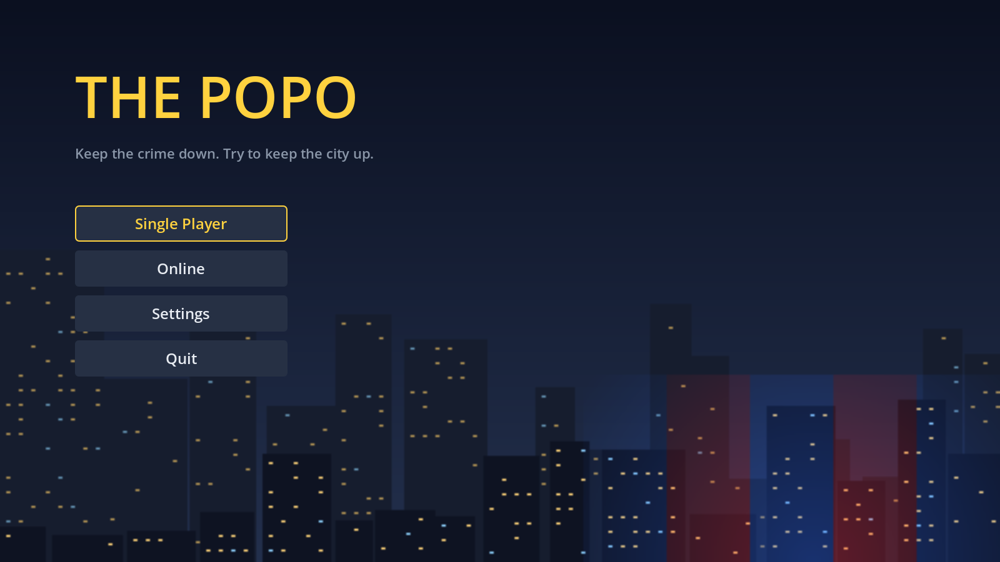
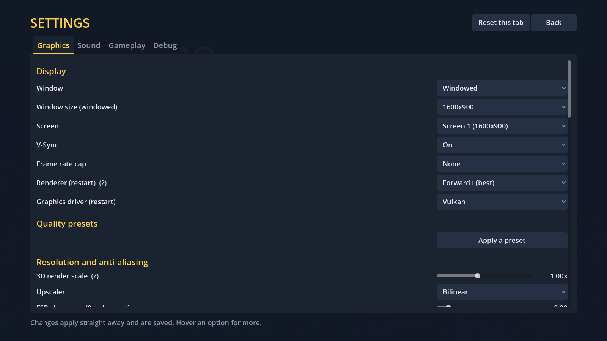
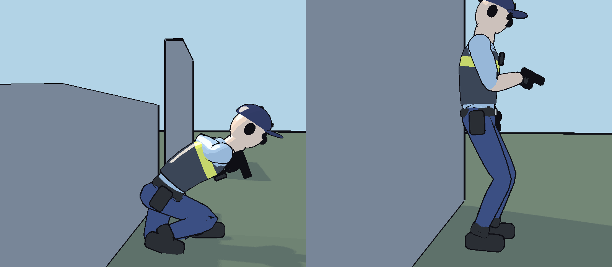

## Phase 1.3: police car (v0.2.4)

- Patrol car built in Blender (`tools/blender/build_police_car.py` writes
  `assets/models/vehicles/police_car.glb`): body, four doors, bonnet, boot,
  bumpers, push bar, mirrors, six windows, roof light bar and an interior.
  It drives on the shared `Car` physics (`game/vehicles/police_car.gd`).
- Damage: body, doors, bonnet and boot dent; parts near a hard hit build up
  damage and come off as loose physics pieces past their limit. Every
  window shatters when shot. Shots and blasts are worked out on the host
  and sent to everyone (`game/actors/gunfire.gd`, `car_sync.gd`).
- Lights and siren: the driver's T cycles lights, lights and wail, lights
  and yelp, off. Lenses flash and light the street; the siren is heard by
  everyone nearby.
- Four seats, so all three officers fit in one car. F at a door gets in,
  F again gets out at the nearest clear door, Ctrl moves to the next free
  seat. The officer in seat 0 drives; passengers hold aim to wind the
  window down, lean out and shoot (with extra spread).
- The boot: hold F behind the car for spare ammo and first aid.
- Injuries (added to the plan after 1.2): shots can wound the leg (limp, no
  sprint), the arm (shaky aim) or cause bleeding (health drains). Holding F
  treats one wound on yourself or a teammate from a pouch of 3; the boot
  fixes everything and refills the pouch.
- Menu change (beenster): Single Player goes straight into the city block,
  which now has two police cars. Online is host / join plus Start the game.
  The test scenes moved to Settings > Debug > Open a test scene, including
  "1.3 Patrol", a test lot with two police cars, civilian cars and ramps.
- Throwing things round or over cover is in a later phase (throwables).

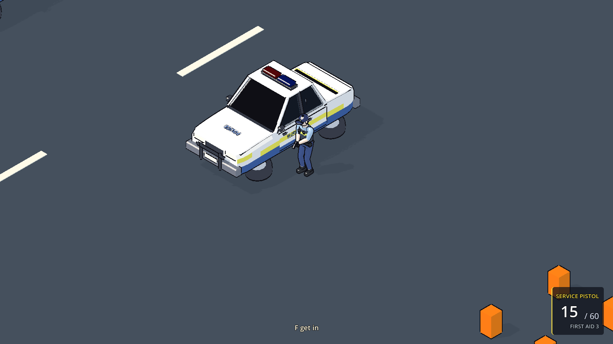
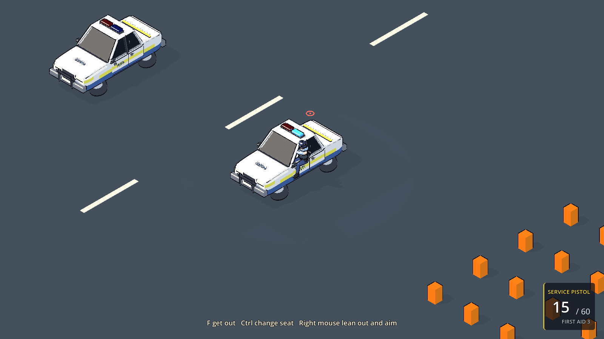
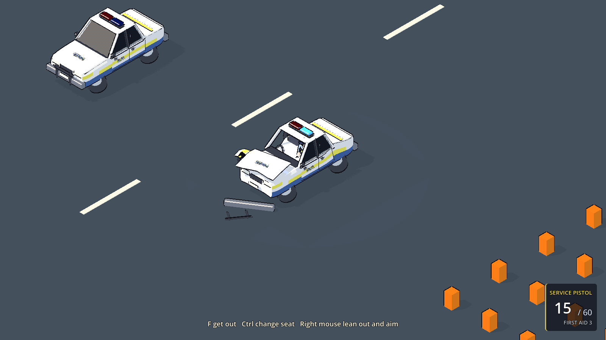
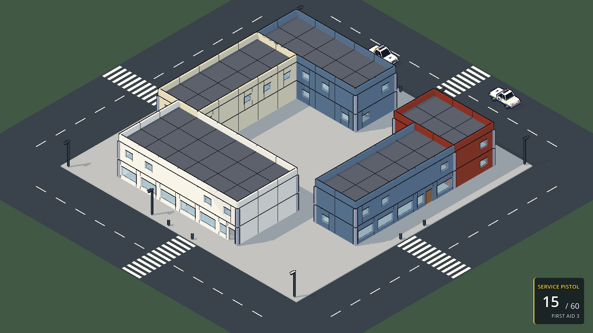

### v0.2.5: playtest fixes (beenster)

- Police car wheels stood flat; they now keep the model's turn and sit
  upright in the arches.
- Officers start with the gun holstered.
- Walk: Alt toggles walking pace (about 1.5 m/s, the walk clip); a light
  tilt of a controller stick walks too.
- Cutaway (`game/render/roof_fader.gd`): walls between the officer and the
  camera on their floor turn see-through instead of vanishing, so doorways
  show; anything over the officer's head or hiding them from the camera
  fades out, inside or out.
- The reticle looks through hidden ceilings, roofs and walls.
- Hold the middle mouse and drag to turn the camera; a click still pings.
- Corner peek: the feet stay at the wall's end (a small side step at most)
  and the body leans out round it (`OfficerProcedural._lean`).
- Steadier aim: the aim target is smoothed and the aim loop barely breathes.
- The support hand locks back onto the grip once the aim pose has blended
  in after a reload or draw.
- Settings sit in a centred panel 1100 px wide, and the UI scales with the
  window (stretch mode canvas items), so 4K is readable.

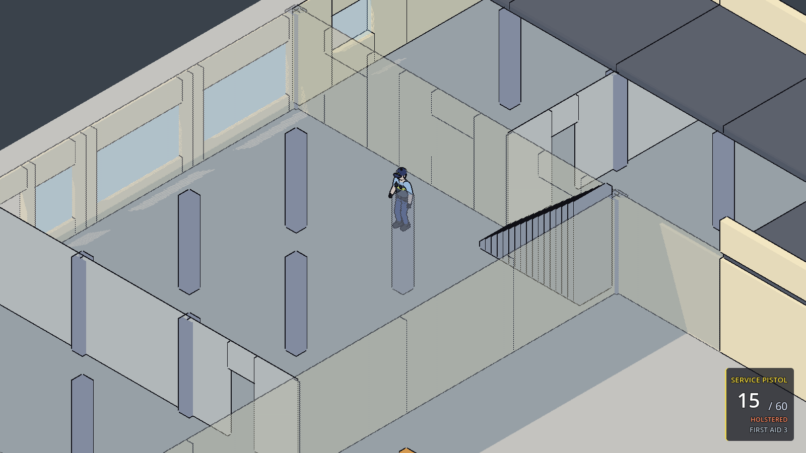

## Phase 1.4: dispatch, suspects and arrests (v0.2.6)

- Dispatcher (`game/missions/dispatcher.gd`, host only, synced to
  everyone): the first call comes in after about 20 s, then one every
  25 to 50 s, at most two open at once. Three kinds for now: a shop
  robbery (two suspects inside), an armed person on the street, and a
  speeding car on the ring road. A call is lost after 5 minutes.
- Crime level (top of the screen): starts at 35, creeps up over time and
  faster with open calls; each suspect dealt with takes 5 off, a closed
  call 10, a lost call adds 8. Arrests and kills count the same.
- HUD (`game/ui/dispatch_hud.gd`): the crime meter, radio lines, the open
  calls with distances, and arrows at the screen edge to each call (and to
  the custody bay while anyone has a prisoner). Calls have a marker beam.
- Suspects (`game/actors/suspect.gd`): civilians in their own clothes
  (`suspect_look.gd`). They notice officers, run and hide in rooms, yards
  and upstairs (a navmesh baked from the block at load, `game/world/
  block_nav.gd`), and armed ones may shoot back instead. Aiming at one up
  close, a punch, or cornering them makes them give up: hands up, kneel.
- Arrests: hold F next to a kneeling suspect to cuff them; they follow
  you. F at a police car door seats them in the back. Drive to the
  CUSTODY bay (yellow box with a blue lamp) to book them.
- Traffic stop: get behind the speeding car with lights on and it pulls
  over; walk up and the driver gets out and gives up, or runs.
- New clips on the officer rig, reused by suspects: hands_up, cuffed,
  kneel.
- The host's J key calls in a job at once (for testing).

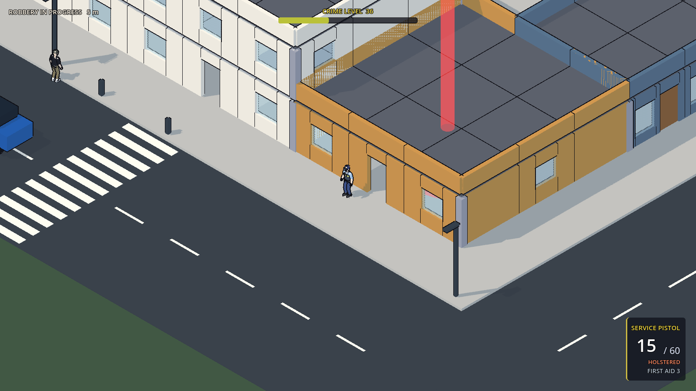
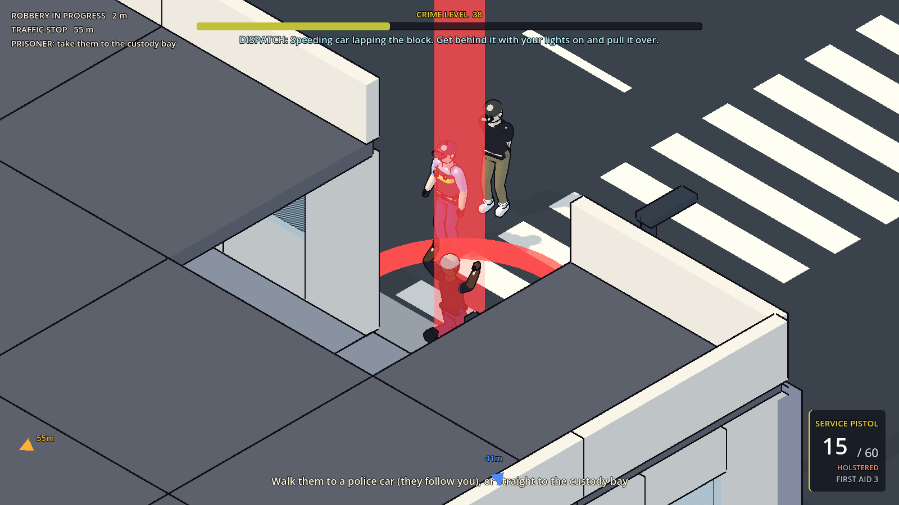
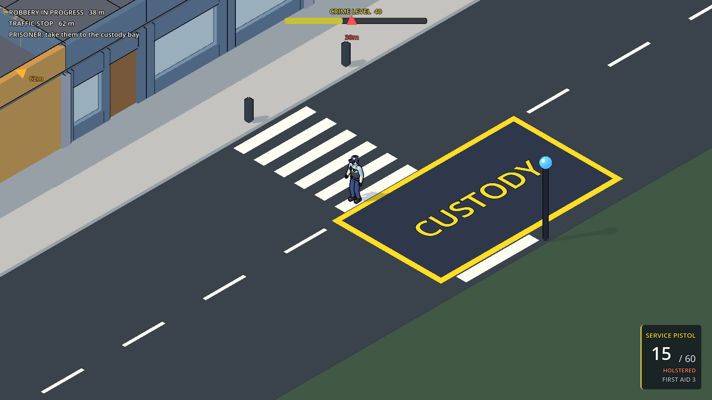

## Phase 1.5: enemies that fight, and a fight that makes a mess (v0.2.8)

Enemies:

- Fighters (armed suspects, "Shots fired" gangs) look for cover facing the
  officers: a spot on the walkable floor hidden when crouched, with
  something solid close in front and a way to shoot from it (stand up over
  low cover or lean out round a corner). From cover they duck, peek and fire
  in bursts, blind fire over the top, and reload in cover. Cover search now
  samples 7 rings of 20 points (it found cover about half the time before;
  now nearly always).
- Bullets passing within 1.8 m pin them down for a moment (no shots back).
- Roles: some pin you down with fire at where you were last seen, others go
  round the side (flank). They retreat to cover further back when hurt or
  outnumbered, and call backup once per call: two more arrive about 9 s
  later from somewhere no officer can see.
- Unarmed fighters pick up loose things (chairs, crates, bins, bottles, gas
  bottles) and throw them at you; a thrown thing hurts whoever it hits
  while it is flying fast.
- Guns: street pistol (12 rounds) and sawn-off pump shotgun (5 shells, 7
  pellets). A suspect who gives up tosses the gun a couple of metres away.
  Officers pick it up with F and get only its loaded rounds (the HUD shows
  the gun's name and "no spare"); H drops it, and an empty one is dropped
  for the service pistol.
- New call: "Shots fired", 3 or 4 armed, one with the shotgun.

The mess (`game/world/props.gd`, `game/world/fire.gd`, `game/world/blast.gd`):

- Props from the block's seed, the same on every machine: tables with
  chairs, shelves with bottles in shops, crates, the odd gas bottle
  indoors; bins, crates, bottles, red barrels and gas bottles in the yards;
  benches on the pavement; a fire extinguisher inside each enterable
  building's door. The host simulates them and streams the moving ones
  (20 a second, 80 a packet, every prop refreshed at least every 1.5 s);
  a late joiner asks what has already broken.
- They break from bullets (14 a round), kicks, blasts, fire and hard knocks
  (a chair thrown at a wall, a bottle dropped): wood splinters, glass
  smashes, metal clangs, each with its sound.
- Red barrels (3 rounds) and gas bottles go up: a blast that hurts people,
  breaks things, dents and damages cars, and leaves a fire.
- Fire burns for a while, catches wooden things within 1.3 m (and wooden
  doors), burns people standing in it, cooks off barrels, and leaves
  embers where something burnt away. Flames, smoke, flickering light, a
  crackle loop and a whoomph as it catches. A shot extinguisher bursts into
  a white cloud that puts out every fire within 4.5 m.
- Cars take damage from bullets (3 a round, 12 in the fuel tank low at the
  back), crashes, blasts and fire. Below 40 they smoke; at 0 they catch
  fire and 7 s later go up, ending as a charred wreck that will not drive.
- One `Blast.go` for every explosion (the demolition charge too): the
  world, people, cars, props and the camera.

Feel (`game/render/feel.gd`):

- Camera shake: your shots (more for the shotgun), rounds cracking past,
  getting hit, blasts by distance. Settings > Gameplay > Camera shake.
- Hit marker: the reticle flares white when your bullet lands on someone,
  with a 45 ms hit-stop when playing alone (never online).
- Muzzle flash light on every officer shot; sparks off metal, splinters off
  wood, glints off glass and a puff of dust off concrete.
- Sounds made for this phase: fire crackle loop, whoomph, extinguisher
  hiss (`tools/audio/make_layers.py`).

Checks: `tests/unit/test_combat.gd` (cover and shooting from it, pinned
down, gang call with flankers and backup, flank spot, throwing, guns
dropped and picked up, shotgun spread) and `tests/unit/test_mayhem.gd`
(furnished block with nothing in a wall, shooting and kicking furniture,
thrown things breaking, a barrel going up and starting a fire, fire
spreading and burning out, an extinguisher, cars smoking, burning and going
up, the camera). `tools/capture/net_check.gd` runs a host and a client on
one machine: the same props, the same breaks, fires and car state on both,
and a knocked chair in the same place to the centimetre.

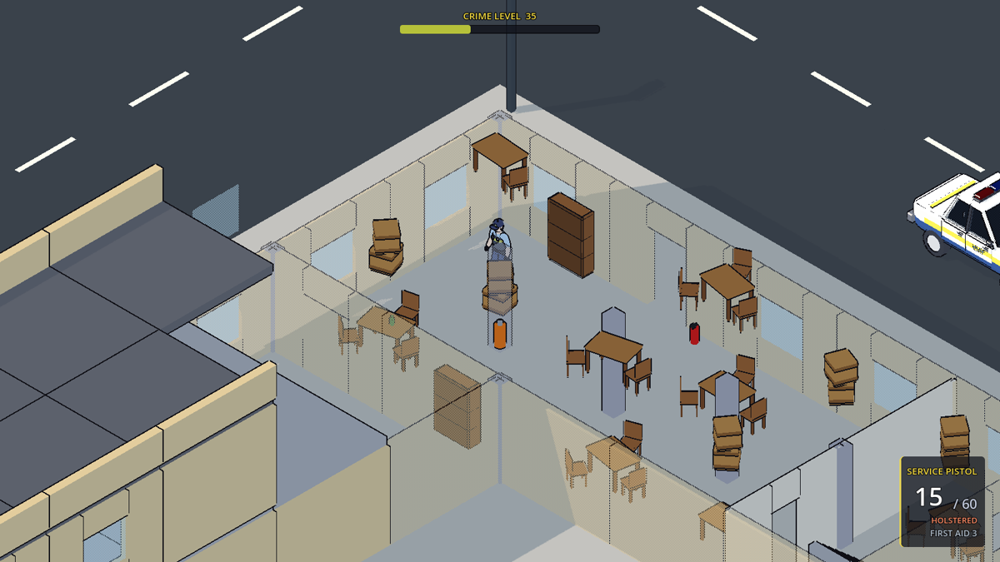
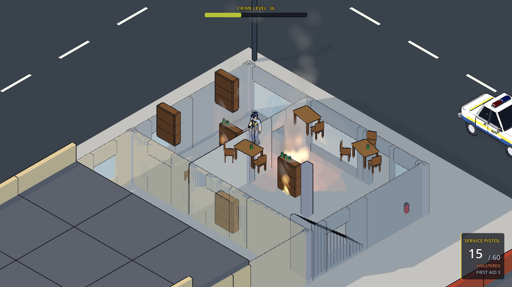
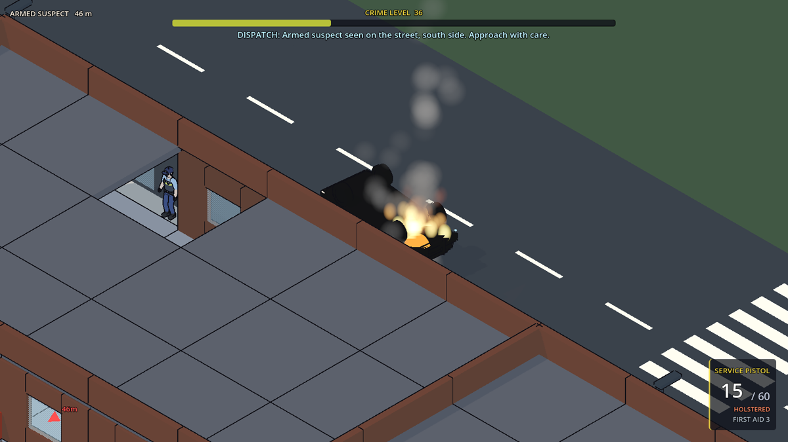

### v0.2.10: heal your friends (beenster)

- First aid now restores health as well as treating wounds: holding F on
  a hurt teammate gives 45 health (25 on yourself), one pouch use each.
  It works on any teammate who has lost health, wounded or not.
- Teammates who are hurt, wounded or down show their health (or DOWN) over
  their heads; your own HUD keeps showing yours.

### v0.2.9: respawn (beenster)

- Downed officers can respawn: after 3 s, R puts you back where you came
  into the game with full health, no wounds, a full pouch, full magazine
  and belt, and the service pistol holstered (a picked-up gun is lost).
  Teammate revive (hold F) and getting up by yourself after 30 s still
  work. The HUD shows the choices and the countdowns while you are down.

## Phase 1.6: sound that hits hard (v0.2.7, pulled forward)

beenster heard nothing in v0.2.5: the officers' own gunshots and bullet
hits had never been hooked up in the city (only the Phase 0.7 sound spike
played them). beenster chose to do all of Phase 1.6 before finishing 1.5.

- `game/audio/game_sounds.gd` (GameSounds), one per playing scene (city,
  patrol, yard, listening room). Each machine works sounds out from what it
  sees; the host only sends where bullets went and what blows landed
  (`SfxSync.bullet`, `SfxSync.melee_hit`).
  - Ears on your officer's head, facing the camera's way.
  - Background: busy street, air, distant traffic; a quiet room tone
    indoors, with the street muffled (one sound zone per building).
  - Footsteps by surface (pavement, grass, boards upstairs and on stairs),
    louder running; kit rattle when officers run.
  - Officers' guns: shot detection from synced ammo, dry click, reload
    (mag out, empty mag hitting the floor by surface, mag in, slide from
    empty), holster, punches and kicks swish, car doors.
  - Brass: each case is a small physics body that plays a bounce on
    concrete, wood or metal where it lands.
  - Cars: engine pitch climbing through the gears, tyre squeal when the car
    slides (handbrake too), crunch on hard knocks.
  - Destruction: glass (panes, shop fronts) with shards settling after,
    doors splintering, walls crumbling with rubble, metal posts; loose
    chunks and props landing hard play their material, with a budget of 10
    a second and close ones merged, so a collapse stays readable.
- `Sfx.shot`: layered gunshot as heard from where you are: the recording
  (near, distant, or a pop past 90 m; dry and louder through the room
  reverb indoors), a low thump up close (a deeper boom for shotguns), the
  slide right next to the gun, and real slapback: echoes from the nearest
  building walls, delayed by the extra distance. Close shots duck the
  background and engines; a shot right by your head (not your own) or a
  close blast rings your ears and muffles everything for a moment.
- `Sfx.bullet`: the hit by surface (or a body), ricochet whines off metal
  and concrete, and the crack (under 1.3 m) or whizz (under 2.4 m) of a
  bullet passing your head.
- `Sfx.explosion`: bang, rumble, rubble, echoes, ear ring.
- Sounds: 89 CC0 recordings from OpenGameArt (`tools/audio/import_phase16.py`)
  and 39 made for the game (`tools/audio/make_layers.py`: thump, shotgun
  boom, crack, whizz, ricochet, casings, mag drops, ear ring, swish, tyre
  squeal, room tone, blast rumble). Every file is in
  `assets/audio/manifest.csv` with its source and licence.
- Settings > Sound gains Background and Engines sliders.
- Listening room (Settings > Debug > Open a test scene > 1.6 Listening
  room): test guns in the street, shop and behind a wall (5, 6, 7), a
  shotgun by your ears (8), bullets past your head (9), a blast (0),
  auto-fire (F4), and a breakable shop, a car and crates to shoot.
  `tools/capture/listen_room.tscn` records a scripted run with the movie
  maker for checking levels.
- Not yet: footsteps for metal stairs (no metal floors in the kit yet),
  gun sounds for the enemy shotgun model (Phase 1.5 brings the gun).

## Phase 1.7: polish, and beenster's playtest of v0.2.10 (v0.2.11)

- Drop-in: a friend joining mid-shift catches up on everything (lost wall
  pieces and where loose rubble lies, broken props, cars with their dents,
  glass and fires) via `BlockState` (messages 95/96). The block saves every
  20 s and on exit; the menu offers Continue. A client whose host drops
  goes back to the menu with a note.
- Third person is the only view (isometric removed at beenster's ask).
- Outlines: the black middle distance was the outline hull drawn in front
  (reversed-Z: the nudge had the wrong sign). Fixed, faded with distance,
  with an Outline strength slider.
- Debris detail setting (Coarse to Ultra): `ChunkSplit` cuts the kit's
  chunks into smaller convex pieces at load, seeded, the same everywhere.
- Gore slider (Off, Some, Lots, Extreme): spray, wall and floor splats,
  wounds, head holes, pools, a bone out on Extreme, bodies jerk when shot.
- Crime level removed: the game is dispatch calls and what happens.
- Car fix: the host's own parked input no longer overrides a driver.
- Sound pass: every gun, impact, glass, breakage, debris, explosion,
  whoosh, casing and gore sound rebuilt from real recordings in the Sonniss
  GDC Game Audio Bundles (`tools/audio/import_sonniss.py`, sources in
  `assets/audio/manifest.csv`). Still made for the game: ricochet whine,
  fire loop, room tone, ear ring, horn, ping.
- Falls: the ragdoll joints sat in the middle of each limb, which folded
  bodies into a heap. Joints now sit at the bone roots with limits, the
  body keeps its momentum and starts stiff then goes limp.
- Drag: hold G (Y on a controller) by a downed teammate to drag them by
  the collar, bent over and backing off at a walk; the body follows on the
  ground, leaving a smear.
