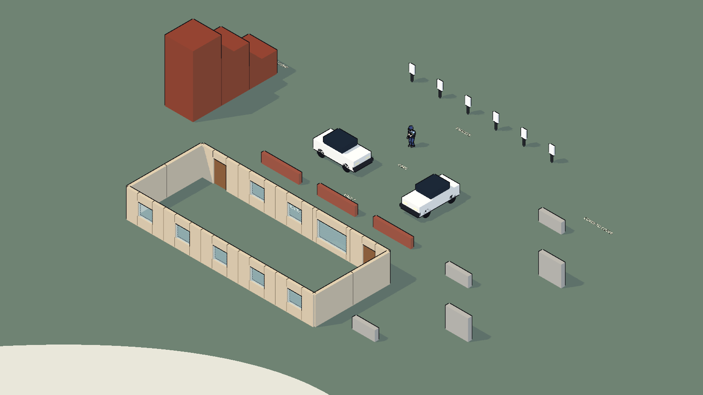

# Wave 1: first playable block

Wave 1 turns the Wave 0 prototypes into one small game loop on a generated
city block. It is built phase by phase; each phase ends with a build.

## Phase 1.1: kit and generator, version 1 (v0.2.0)

- Grid standard: [grid.md](grid.md) (4 m modules, 3.25 m storeys).
- Kit: 34 pieces (walls, shop fronts, garage, parapets, interior walls,
  floors, stairwell and stairs, roofs, columns, glass, doors, pavement,
  roads, crossings, low wall, bollard, lamp post), each with its fractured
  twin, from `tools/blender/build_kit_fractured.py`.
- Generator: `game/city/block_generator.gd` lays out one block from a seed:
  a road ring with lane dashes and crossings, pavement, and 4 to 6 buildings
  (shops, houses, garages, 1 to 3 storeys, recoloured per building). Two are
  enterable, with rooms, an interior door and stairs to the floor above.
- Everything is breakable: the block is built into the DestructionWorld, so
  walls, floors, glass and lamp posts shatter and fall like the Wave 0 shops.
- Same seed, same block: checked by `tests/unit/test_city_block.gd` (same
  fingerprint for the same seed, a different one for another seed; 40 seeds
  checked for 4 to 6 buildings, two enterable, none overlapping; the whole
  block stands; an officer walks up the stairs). The host sends the seed to
  everyone, so all machines build the same block with the same piece ids.
- Officers now step up stairs and kerbs (up to 0.36 m).
- Playable as "1.1 City block" in the launcher. G (host) builds a new block
  for everyone.

## Phase 1.2: movement and gunplay (v0.2.1)

- Climb, roll and mantle polish: hands stay on the ledge through a climb,
  rolls and vaults finish at running pace instead of stopping dead.
- Gun handling: 15-round magazine, reload (R), holster and draw (H), recoil
  kick and spread bloom, blind fire from cover (fire without aiming), torch
  (T) that everyone sees.
- Traversal: one forward scan finds the top of whatever is ahead, so the
  officer vaults low walls, car bonnets and window sills once the glass is
  gone (glass shards and splinters never block), and climbs ledges up to
  2.4 m.
- Cover: walls, cars and rubble all give cover. In cover, a direction plus
  the cover key runs to the next cover that way (up to 10 m), or swings round
  the end of the wall to its side face.
- Melee: punch (shoves and hurts), kick (bursts doors in off their hinges,
  breaks other pieces), and a shoulder barge when sprinting. All hits are
  worked out on the host (`game/actors/melee.gd`).
- Health: 100 hp. Shots (friendly fire is on), blasts and falls of more than
  about 4 m hurt. At zero the officer goes down (full ragdoll); a teammate
  holding interact next to them for 2 s gets them up with 50 hp, or they get
  up alone after 30 s with 25 hp. Health, revive progress and stagger are in
  the synced officer state.
- Playable as "1.2 Training yard" in the launcher; the City block also has
  melee, kickable doors and friendly fire.
- Ladders are left for later: none of the kit pieces needs one yet.

