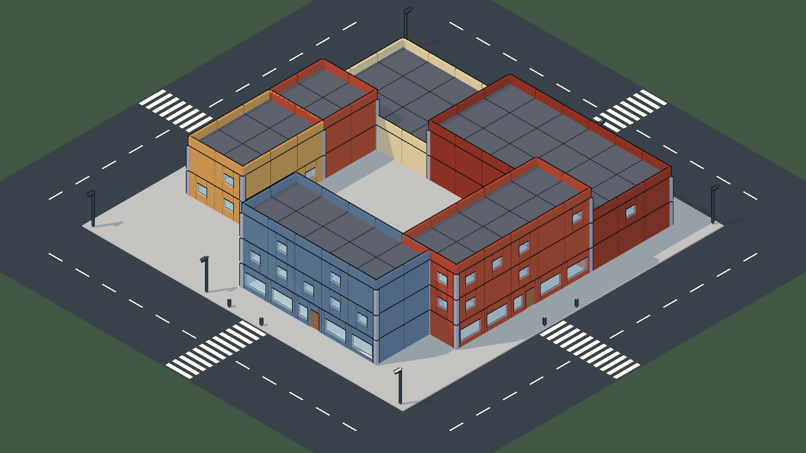

# Wave 1: first playable block

Wave 1 turns the Wave 0 prototypes into one small game loop on a generated
city block. It is built phase by phase; each phase ends with a build.

## Phase 1.1: kit and generator, version 1 (v0.2.0)

- Grid standard: [grid.md](grid.md) (4 m modules, 3.25 m storeys).
- Kit: 34 pieces (walls, shop fronts, garage, parapets, interior walls,
  floors, stairwell and stairs, roofs, columns, glass, doors, pavement,
  roads, crossings, low wall, bollard, lamp post), each with its fractured
  twin, from `tools/blender/build_kit_fractured.py`.
- Generator: `game/city/block_generator.gd` lays out one block from a seed:
  a road ring with lane dashes and crossings, pavement, and 4 to 6 buildings
  (shops, houses, garages, 1 to 3 storeys, recoloured per building). Two are
  enterable, with rooms, an interior door and stairs to the floor above.
- Everything is breakable: the block is built into the DestructionWorld, so
  walls, floors, glass and lamp posts shatter and fall like the Wave 0 shops.
- Same seed, same block: checked by `tests/unit/test_city_block.gd` (same
  fingerprint for the same seed, a different one for another seed; 40 seeds
  checked for 4 to 6 buildings, two enterable, none overlapping; the whole
  block stands; an officer walks up the stairs). The host sends the seed to
  everyone, so all machines build the same block with the same piece ids.
- Officers now step up stairs and kerbs (up to 0.36 m).
- Playable as "1.1 City block" in the launcher. G (host) builds a new block
  for everyone.

