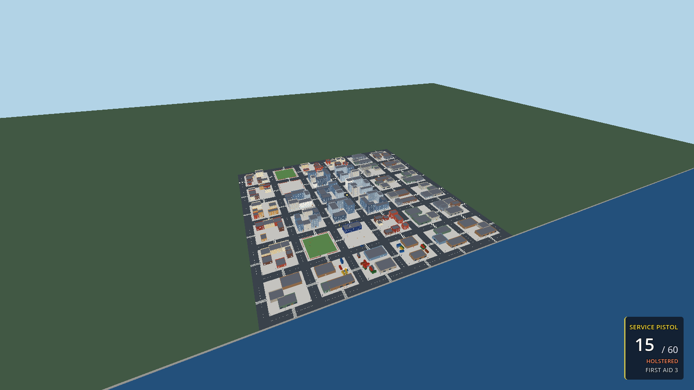
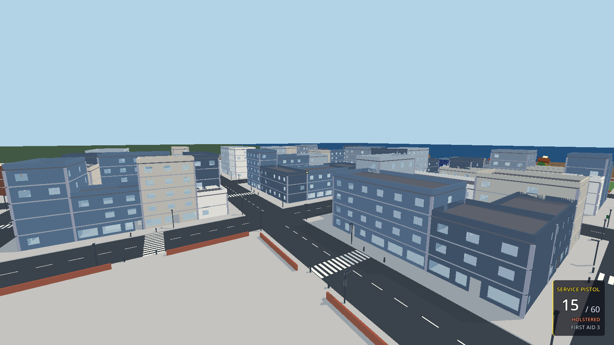
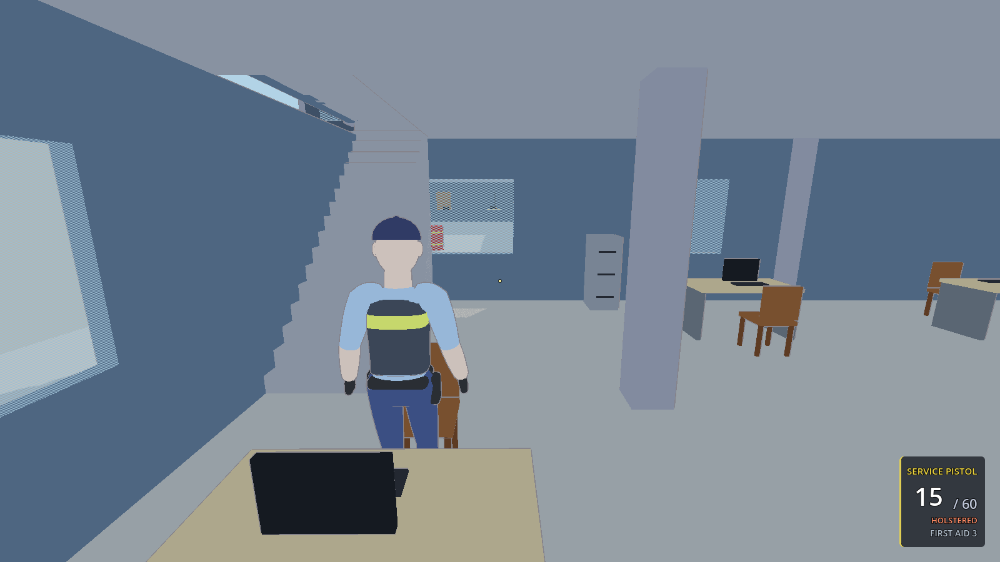
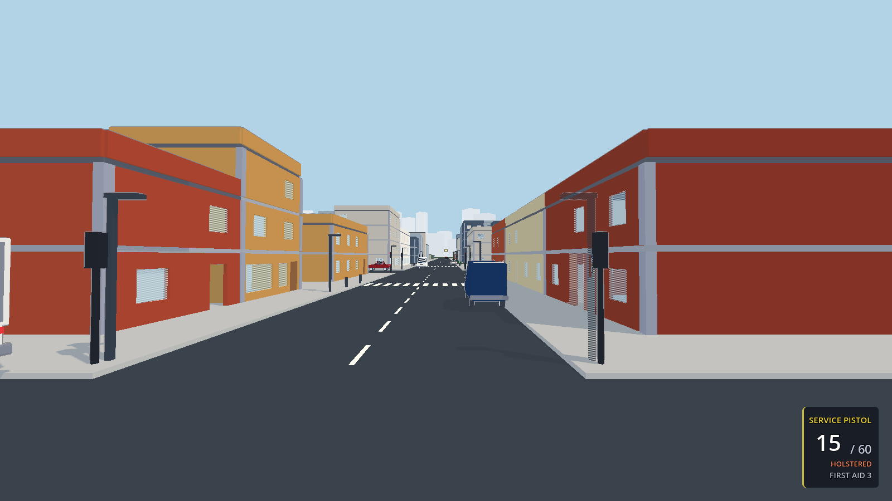

# Wave 2: the whole city (v0.3.0)

Wave 2 grows the single block into a whole procedural city with traffic,
people, every vehicle, and car crime. The game now starts at the police
station in the middle of town.

## Phase 2.1: city layout, districts, police station

- `game/city/city_generator.gd` builds the whole city from one seed: six by
  six blocks on a 60 m grid (372 m across), a 12 m road between every block
  (one lane each way plus kerbside parking), and four districts:
  - **docks** along the water on the south side: warehouses and container
    yards on the quay,
  - **industrial** in the two east columns: warehouses, garages, yards,
  - **downtown** in the middle: offices and shops, three to five storeys,
  - **residential** round the rest: houses, flats, corner shops,
  - plus two parks, a car park and the **police station**,
    where everyone starts, the patrol cars are parked and prisoners are
    booked in at the custody bay round the side.
- Every street has a name (Mercer Street, Chapel Road...). The radio and the
  overlay use them ("Robbery in progress at the shop on Mercer Street near
  Chapel Road").
- The host sends the seed, so every machine builds the same city with the
  same piece ids. G (host) makes a new city.
- The whole city is built at load (about 18,600 breakable pieces, 3 to 4
  seconds). Roads and pavements are a few merged meshes instead of breakable
  tiles.
- Calls happen in a block near the officers, never across town.

## Phase 2.2: interiors at scale

- Every building can be entered (a third are locked: kick the door in).
  Every floor has stairs, and interior walls split each floor into rooms by
  building type: living rooms, kitchens, bedrooms and bathrooms; shop floors
  and stock rooms; offices and meeting rooms; lobbies; cells in the station.
- Furniture by room (beds, sofas, desks, counters, cabinets,
  pallets, shipping containers in the yards) is put into a block as officers
  come near it, so the city doesn't carry thousands of loose objects nobody
  is near. Walking routes are baked a block at a time, nearest first.

## Phase 2.3: traffic and people

- 22 vehicles drive the streets on the right, turning at random at the
  junctions, and 30 more are parked along the kerbs.
- Traffic lights at every junction with three or four roads, on a shared
  clock (everyone sees the same lights). Drivers stop at red, and at amber
  when they can, keep their distance, and sound the horn when stuck.
- A police car with its siren going: drivers pull over to the kerb and stop.
- Gunfire, blasts and buildings coming down: drivers nearby floor it, or
  stop, get out and run.
- About two dozen people walk the pavements round the officers. Gunfire,
  blasts and falling pieces send them running or crouching with their hands
  over their heads; when it's quiet they carry on. Aim at one and they put
  their hands up like anyone else.
- A car that hits someone at speed knocks them down and hurts them (officers
  too).

## Phase 2.4: every vehicle

- New models (`tools/blender/build_vehicles.py`): saloon, hatchback, panel
  van, box van, minibus, bin lorry with a working bin lifter, HGV tractor
  with box, tanker and flatbed trailers, motorbike. Each has its own size,
  weight, engine, seats and doors, and dents, loses panels and shatters
  glass like the police car.
- Articulated lorries pull their trailer through a ball joint at the fifth
  wheel: it follows round corners, swings out, and can jackknife. A big
  enough crash knocks it off the hitch; then it drops onto its landing legs.
  Heavy: it ploughs through cars and shop fronts.
- Commandeering: an officer can get into any vehicle. The driver is pulled
  out and runs.

## Wave 2 jobs: car thieves and pursuits

- **Car theft**: someone breaking into a parked car. Get there in time and
  they run for it on foot; leave it 20 seconds and they're in and away, and
  it becomes a pursuit.
- **Pursuit**: a stolen car driven hard through town, ignoring the lights
  and turning away from the police. Ram it, box it in or shoot it up: once
  it's stopped with officers close, or smashed, the driver bails out and
  runs (some are armed). The call marker follows the car every second.

## Sound (track S3)

- Gunshots, heavier: a whip-like supersonic crack at the front of every
  close shot, a sub-bass boom you feel, and outdoors the shot rolls round
  the streets as a long echo (from across town that echo is most of what
  you hear). Made by `tools/audio/make_wave2.py`.
- District ambience: water and creaking and a far ship's horn at the docks,
  factory hum and clanks in the industrial district, wind and birds in the
  parks; the busy street is loudest downtown.
- Every vehicle has its own engine note (lorries low, bikes high), and
  sirens and engines rise and fall as they pass (Doppler).

## Phase 2.5: performance

- Per-frame work no longer scales with the size of the city: rubble, props
  and impact sounds only look at what is awake or within earshot (the city
  frame went from about 31 ms to 16 ms in headless tests).
- Far buildings: beyond 170 m a building's pieces stop drawing and a single
  block in its colour stands in for it. Small pieces (glass, doors) stop at
  110 m.
- A skyline of far towers and a light haze round the city.
- Parked cars that are asleep are left out of the network snapshots.

## Tests

`tests/unit/test_traffic.gd` (traffic drives its lanes and waits at red
lights; people walk and scatter; a car knocks someone down; a car theft
turns into a pursuit and the driver bails) and
`tests/unit/test_vehicles.gd` (every vehicle settles, drives, turns and stays
upright; the artic pulls its trailer round a corner).

## Pictures

