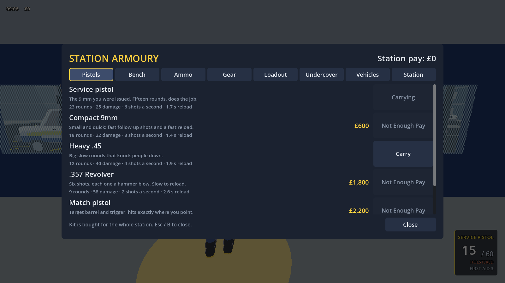
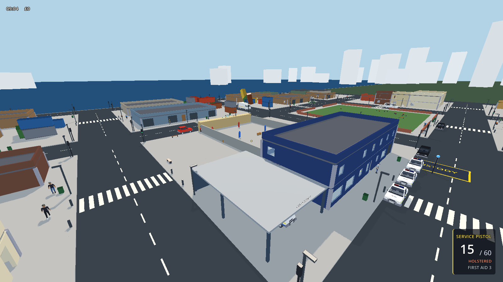

# Wave 3: missions and progression (v0.4.0)

Wave 3 turns the call-outs into proper police work: jobs that fit the place
and the hour, jobs inside buildings, running stories, big busts, pay, an
armoury to spend it in, and undercover work.

## Phase 3.1: dispatcher version 2

- `game/missions/missions.gd`: every job is a template with weights by
  district (downtown, residential, industrial, docks) and time of day. The
  city has a clock (48 real minutes a day), shown on the HUD and synced.
- New street jobs: mugging, shoplifter, fight, domestic, drug deal, vandal,
  drunk. Each starts with its people in place.
- Victims stay put and describe the suspect and which way they went when an
  officer reaches them; witnesses point. The call marker moves to the suspect.
- Chance encounters: a crime starts up the street from an officer with no
  call. It goes out on the radio when an officer sees it, and is gone after
  two minutes if nobody does.

## Phase 3.2: indoor jobs

- Burglary, raid (warrant on a locked building, suspects on every floor:
  dispatch calls each floor clear), hostages (kneeling, can't be cuffed, walk
  free once the takers are dealt with) and building search.

## Phase 3.3: story chains

- `game/missions/stories.gd`: THE VIPERS (a deal, their yard, a raid on Ray
  Vance), COUNCILLOR HALE (a bribe, a search, the chase) and THE MAGPIE
  (burglary, shoplifting, a car theft, the chase). Characters keep their
  face and name; get away and they come back armed, tougher, and taunt you
  on the radio.

## Phase 3.4: arrests, pay and big busts

- Y / d-pad up shouts "Police! Get down!": unarmed suspects mostly give up,
  drunks need you close, brawlers stop, civilians get down.
- Pay for the station: per job closed and per suspect brought in (booked or
  down, the same: no conduct score), a bonus for story characters brought in
  alive and for finishing a story.
- Gang war: two crews of three shooting it out with each other until the
  police get close. Bank job: armed robbers and staff held inside, a getaway
  driver at the kerb who drives off when the shooting starts.

## Phase 3.5: progression

- `game/station/armoury.gd`: the armoury counter inside the station door
  (`game/ui/armoury_screen.gd`). Bought for the whole station, synced:
  - Pistols: service 9 mm, compact 9 mm, heavy .45, .357 revolver, match
    pistol, machine pistol. Heavier guns sound heavier.
  - Bench upgrades: extended magazines, compensators, match barrels, speed
    loaders.
  - Ammo: hollow point (more damage), armour piercing (through cars, glass,
    doors and thin walls).
  - Gear: body armour, ammo pouches.
  - Vehicles (they wait locked in the yard): interceptor, prisoner van.
  - The station grows: a garage beside it, a firing range behind it.

## Phase 3.6: loadouts and the range

- Each officer carries one extra: ammo backpack, three breach charges, two
  blocks of C4 (2, aim, fire: it sticks where you aim, beeps and goes off),
  or a tactical torch. Charges refill from a patrol car's boot.
- The firing range: 30 second runs, swing-up targets at 8 to 25 m, red
  crooks score, blue civilians cost you. Best score on the board.

## Phase 3.7: undercover and stings

- Plain clothes from the armoury: suspects ignore you until you draw, shout,
  arrive in a marked car or linger too close; a suspicion meter on the HUD.
- Unmarked car.
- Stings: the bait car (let him take it: after a few seconds it's shut down
  and he's trapped) and the fake buy (buy from a dealer in plain clothes for
  an evidence bonus, then take him).

## Fixes

- The skyline from v0.3.0 is visible now (the camera's far plane was too
  short to see it).

## Tests

`tests/unit/test_missions.gd` (templates and the clock, every job starts,
victims and encounters, indoor jobs, story chains, arrests, pay and big busts)
and `tests/unit/test_station.gd` (the armoury, loadouts and the range,
undercover and stings).

## Pictures

