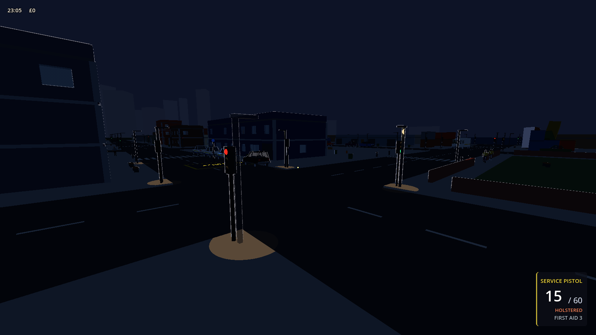
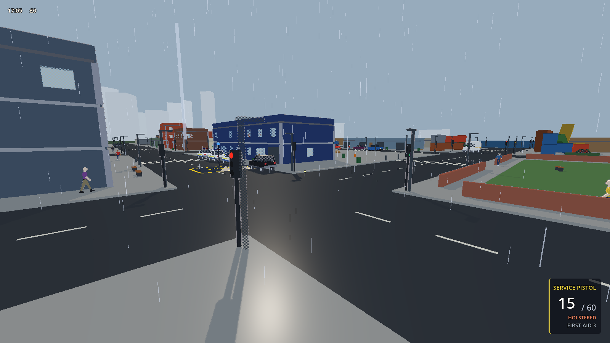

# Wave 4: the city fights back and heals (v0.5.0)

Wave 4 makes the city feel alive between jobs: the day turns to night, the
weather changes, things go wrong on their own, the damage gets cleared up
and rebuilt, and the station's career is saved between sessions.

## Phase 4.1: repair crews

- `game/city/repair.gd` (RepairCrews, host): about 40 seconds after
  something is knocked down, a site opens (up to three at once, rubble in
  the road first). Damage close to a site joins it.
- The crew: a van borrowed from the traffic and parked at the kerb, two or
  three council workers (civilians in hi-vis and hard hats: looks from
  `SuspectLook.WORKER` up) walking the site, and a ring of cones with a
  ROAD WORKS sign (MSG 108).
- Clean-up first: rubble is carted away a load at a time, nearest the road
  first (`DestructionWorld.clear_bodies`, MSG 23). Then the rebuild, bottom
  up, glass and doors after their wall (`restore_piece`, MSG 24), never
  where someone is standing.
- Slow while an officer is within 120 m, quicker when nobody is about, but
  always a piece at a time.
- A frightened or hurt worker stops the job until they're back at work; if
  the whole crew is down, a new crew comes a minute later.

## Phase 4.2: things that just happen

- New jobs from the same templates: CRASH (two cars wrecked in the road,
  more likely in the rain), FIRE (a building on fire) and ALARM (a burglar
  alarm). Officers on scene for a while close them.

## Phase 4.3: day, night and weather

- `game/city/city_weather.gd` (CityWeather): the sun follows the clock; at
  night up to 14 street lamps round the camera light up. The skyline darkens
  with the sky.
- The host changes the weather now and then (clear, cloudy, rain, storm with
  thunder and lightning) and tells everyone (MSG 107). Rain wets the roads
  (dark, shiny overlay) and costs grip (`Car.grip_k`, down to 70%).
- Host keys: K changes the weather, N moves the clock on three hours.

## Phase 4.4: saving

- The city save (version 4) now also keeps the career: pay, the armoury's
  bought items, each story's progress, the clock, the weather and wet roads,
  and each officer's kit and plain clothes by player name. Continue puts it
  all back; an officer who joins later gets their kit when they turn up.

## Tests

- `tests/unit/test_repair.gd`: a wall blown out is cleared and rebuilt and
  stays up; a scared crew stops work; a downed crew is replaced.
- `tests/unit/test_weather.gd`: day, night, lamps, rain, grip.
- `tests/unit/test_station.gd`: Continue keeps the career.
- `tests/unit/test_missions.gd`: things that just happen.

